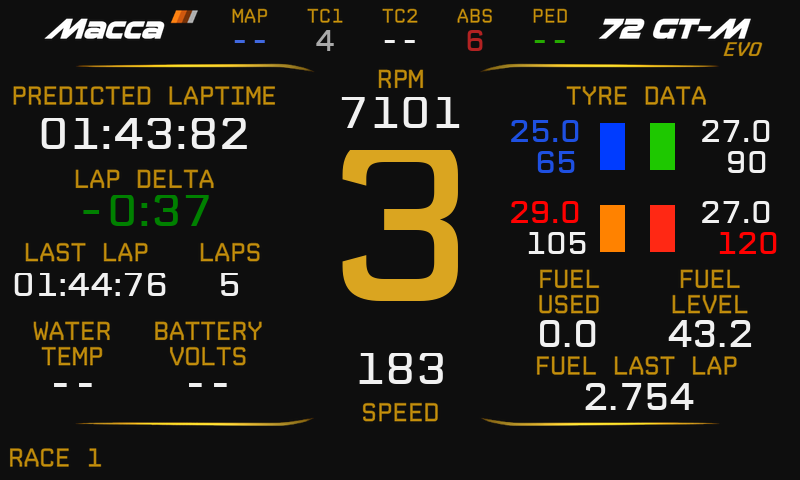

# Macca SimHub Dash

将 RSS GT-M Macca 72 EVO V8 的仪表与转速灯转换为 SimHub 配置，适配 SIMAGIC Zeus 配套的 MagicDash 4（800×480、顶部 15 颗转速灯）。

当前版本：**v0.3**。

*示例数据的静态预览，不是实机截图。*

## 下载与安装

1. 下载本仓库（Code → Download ZIP）并解压。
2. 安装 [MaccaRSSDisplay-Regular.ttf](fonts/MaccaRSSDisplay-Regular.ttf)，完全退出并重启 SimHub。字体名称应为 **Macca RSS Display**。
3. 双击下方仪表包导入，在 SimHub → Devices → MagicDash 4 → Main dashboard 中选择对应的 **v0.3** 仪表。

| 仪表包 | 用途 |
|---|---|
| [原车布局版](dashboards/Macca%2072%20EVO%20-%20MagicDash%204%20v0.3.simhubdash) | 保留原车仪表布局，配合实体转速灯 |
| [屏幕转速灯版](dashboards/Macca%2072%20EVO%20-%20Screen%20LEDs%20v0.3.simhubdash) | 顶部增加一排屏幕转速灯 |

实体转速灯：在设备的 LED 配置中导入并加载 [15 颗转速灯配置](leds/Macca%2072%20EVO%20-%2015%20RPM%20LEDs.ledsprofile)。默认起始位置为 1；可用 [单灯顺序测试](leds/MagicDash%204%20-%20LED%20order%20test.ledsprofile) 确认顶部灯珠从左到右的地址。侧灯、按钮灯不在本配置范围内。

## 主要功能

- 正常行驶、进站和等待三个页面。
- 挡位、RPM、速度、圈速、Delta、四轮胎温与胎压、油量及每圈油耗。
- 原车 10 段转速灯规则对称映射到 15 颗灯，包含按挡位阈值和进站速度提示。
- 按原车曲线着色：冷胎蓝、适温绿、过热橙红；干胎目标 **90°C**，雨胎 **45°C**，理想胎压 **27 psi**。
- 胎温偏离目标超过 ±15°C、胎压超过 ±1.5 psi 时，数字显示蓝色或红色。
- 轮胎颜色共用 250 ms 缓存，实时挡位、RPM、速度保持快速刷新；保留字体族名称修正。

实现参考了 [Lovely Dashboard](https://github.com/Lovely-Sim-Racing/lovely-dashboard) 正式包中的缓存与刷新配置，保留 RSS 原车布局、字形和颜色规则。

## 当前限制

- 已通过离线逻辑、阈值、缺失数据、缓存、字体字形与资源完整性检查；**Windows SimHub 导入、USB 稳定性和实物灯珠映射仍待验收**。
- 使用 **°C / psi** 遥测单位。无法识别轮胎配方时，采用车辆默认干胎目标。
- TC2、PED、电池电压等 CSP 私有字段尚未接入，显示 `--`；其他不可用数据也可能显示 `--`。
- 进站限速无法读取时默认 **80 km/h**。其他限速需同步调整仪表与 LED 公式中的 fallback。
- 原车普通转速灯逻辑在 6 挡或 RPM ≥7850 时关闭；本配置保留该行为。

仓库仅保留当前可导入文件和必要资源，不包含完整车辆包、旧版本或研究资料。素材与字体归属见 [NOTICE](NOTICE.md)。
