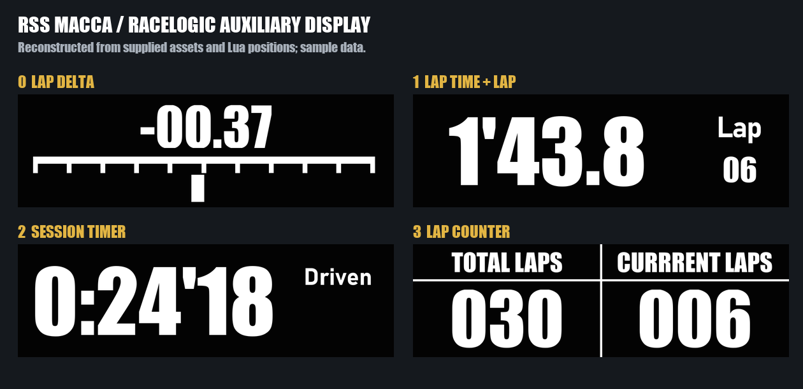
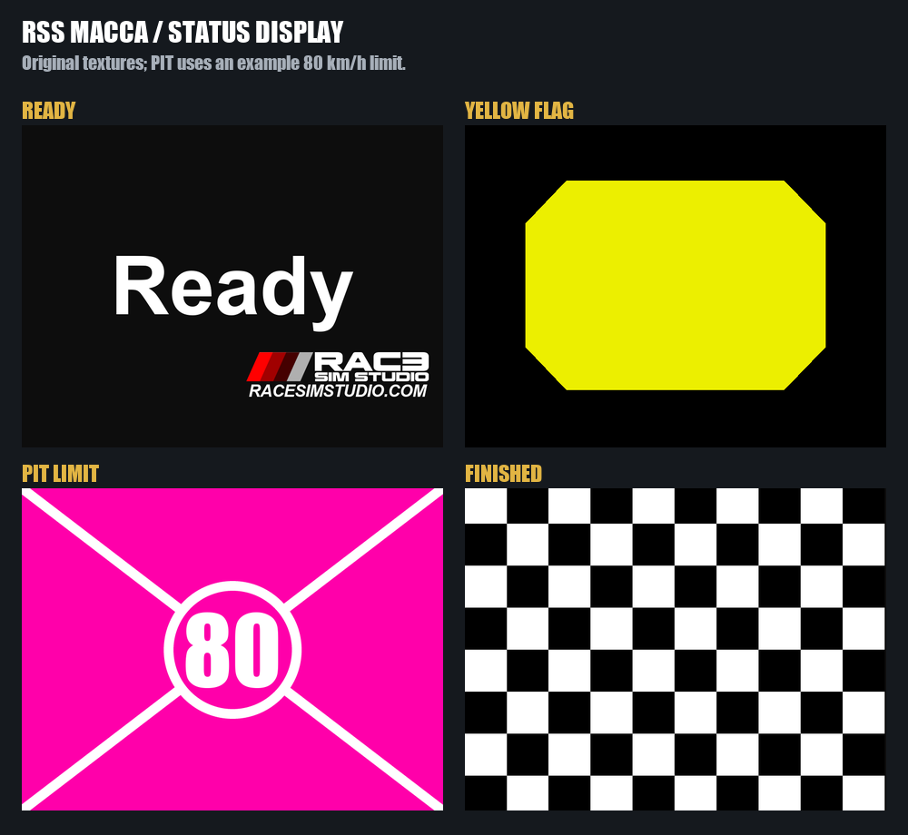
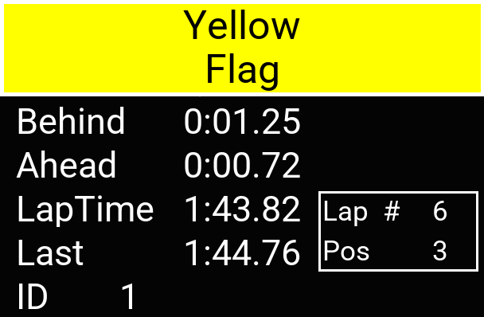

# 原车其他辅助显示屏

这些预览根据用户提供的原车图像、字体和 Lua 绘制位置重建，使用示例数值；不是游戏截图，也不代表它们已移植进当前 SimHub 仪表。

## RaceLogic 圈速计的 4 个页面

- Page 0：圈速差与横向 Delta 条。参考圈未建立时，会显示等待起跑线或创建参考圈。
- Page 1：当前圈用时和当前圈数。
- Page 2：本次会话累计时间。
- Page 3：总圈数与当前圈数。

它还有独立的进站速度显示和启动画面。原脚本支持黑底白字与反色主题；图中展示黑底主题。

## 旗语 / 进站辅助屏

原素材包含 Ready、黄旗、进站限速和方格旗；脚本另有蓝旗、绿旗和最后一圈提示。预览中的限速 80 为示例。

## 副驾驶信息屏（IMSA 模式）

显示旗语、前后车差距、当前圈时间、上圈时间、圈数与名次。另有以大面积旗语提示为主的 EU 模式。

当前主仪表仍是 RACE 1 / PIT / IDLE，这些是车内不同辅助设备的界面，并非主屏中遗漏的 RACE 2、RACE 3。

原始图像、字体及设计归相应权利人所有，参见 [NOTICE](../NOTICE.md)。
