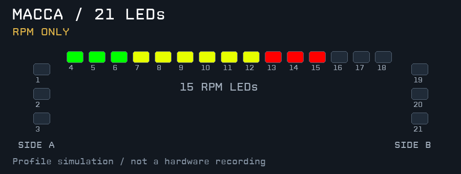

# MagicDash 4：21 颗 LED 配置

适用于已确认的统一编号：

```text
侧灯 A：1 2 3  |  顶部转速灯：4 … 18  |  侧灯 B：19 20 21
```

当前仪表为 v0.3.2；LED 配置为 **Macca 72 EVO - 21 LEDs v1.0**。顶部转速灯每次公式更新都读取最新 RPM，没有额外节流；本次仪表升级不需要重新导入 LED 配置。



*动画由同一份 LED 公式的模拟输出生成，不是实物录像。*

## 安装

1. 在 SimHub → Devices → **MagicDash 4** → LEDs 的配置管理中导入 [21 灯配置](../leds/Macca%2072%20EVO%20-%2021%20LEDs.ledsprofile)，并加载 **Macca 72 EVO - 21 LEDs v1.0**。
2. 用它替换原先的 15 灯配置。21 灯使用同一个 Scripted Content 效果，起始位置 **1**，输出数量 **21**。中间转速段已内置偏移到 **4–18**，不要再额外将整个效果起点改成 4。
3. 初次可先加载 [21 灯顺序测试](../leds/MagicDash%204%20-%2021%20LED%20order%20test.ledsprofile)：白灯应依次经过侧灯 A 的 3 颗、顶部 15 颗、侧灯 B 的 3 颗，每步 0.7 秒。测试不需要启动游戏。
4. 确认编号后切回主配置，并进入 RSS Macca 会话。主配置默认使用 30% 亮度，可在 SimHub 中调整。

这是 MagicDash 4 屏幕模块的 21 灯配置，不包含 Zeus 方向盘的按钮或旋钮灯。侧灯 A/B 不假定组内哪个灯是上方；旗语和进站效果对两侧对称工作。

## 灯效

| 条件 | 两侧 6 颗灯的效果 |
|---|---|
| 红旗 | 红色闪烁 |
| 黑旗 | 红色与紫色交替 |
| 黄旗 | 黄色闪烁 |
| 方格旗 / 完赛 | 白色交错闪烁 |
| 蓝旗 | 蓝色闪烁 |
| 白旗 | 白色慢闪；具体旗语含义由游戏决定 |
| 进站限速开启或位于 pit lane | 浅蓝色闪烁 |
| 进站状态下车速超过限速 | 浅蓝色与红色交替 |
| 绿旗出现 | 绿色闪烁 5 秒；不会因持续绿旗整场不停闪 |
| ABS 实际介入 | 每侧外侧两颗橙色；结束后保留 150 ms，便于看清短脉冲 |
| TC 实际介入 | 每侧中间一颗紫色；结束后保留 150 ms |
| 低油量 | 每侧中间一颗橙色慢闪；低于 5 L 或不足估算 1.2 圈 |

优先级从高到低：**红旗 → 黑旗 → 黄旗 → 方格旗 → 蓝旗 → 白旗 → 进站 → 绿旗 → ABS/TC → 低油量**。ABS 和 TC 可同时显示。

顶部 **4–18** 始终保留原车的转速 / 进站速度灯条逻辑，旗语不会把中间 15 灯覆盖掉。原车 10 段依次映射到 15 灯，挡位阈值、全蓝/对称红蓝、6 挡和 7850 RPM 截止行为不变。

侧灯是按这套 6 灯布局新增的功能，不是原车 10 颗侧灯的逐灯复制。

## 数据与适用范围

- 主配置在退出游戏时清空全部 21 灯；读得到车型 ID 时，仅对 `rss_gtm_macca_72_evo_v8` 及其同名前缀变体启用。
- 旗语使用 SimHub 的 `Flag_Red`、`Flag_Black`、`Flag_Yellow`、`Flag_Checkered`、`Flag_Blue`、`Flag_White`、`Flag_Green`。**具体游戏或服务器必须实际提供对应信号**。没有红旗/绿旗数据时不会推算或伪造这两种提示。
- ABS / TC 使用实际介入信号 `ABSActive` / `TCActive`，不把 `ABSLevel` / `TCLevel` 的设置值当作介入。若原生遥测未提供，该提示不会点亮。
- 如果你用 UDPConnector 补充了信号，可在效果的 JavaScript 顶部 `CONFIG.extraProperties` 中填写可用属性列表里的完整名称。例如将 `ABSActive` 对应的空字符串改为实际 ABSInAction 属性路径。这里不预填未经确认的插件前缀。
- 进站限速优先读取有效的 `PitSpeedLimit`，否则为 **80 km/h**。赛道为其他限速时，修改公式顶部 `CONFIG.pitLimitFallbackKmh`；仪表中的限速设置也需要同步。

## 验证

离线对照原 15 灯公式，检查所有挡位转速阈值及进站速度边界，中间 15 灯结果保持一致。另检查了侧灯编号、闪烁相位、优先级、短绿旗持续提示、持续绿旗超时、ABS/TC 保留时间、缺失数据、其他车型、退出游戏清灯和 21 灯校准。

这些检查不等同于 Windows/Jint 和硬件验收。源代码在 `tools/macca_21_leds.js`，运行 `python3 tools/build_21_leds.py` 生成配置，运行 `node tools/test_21_leds.js` 验证。
